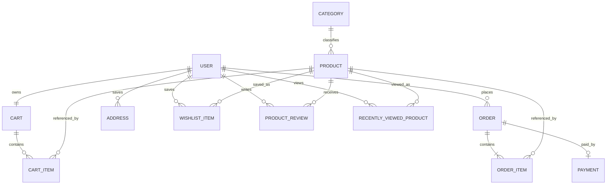

# Database Design

The schema is managed by versioned Flyway SQL migrations under `backend/src/main/resources/db/migration`. Hibernate uses `spring.jpa.hibernate.ddl-auto=validate` and checks that the database matches those migrations at startup. The current schema is at migration V8.

## Entity Relationships

Orders keep coupon code and discount amount as a checkout-time snapshot; they do not hold a foreign-key relationship to the current coupon row.

## Tables and Constraints

| Entity          | Important fields and relationships                                             | Constraints in code                                                       |
| --------------- | ------------------------------------------------------------------------------ | ------------------------------------------------------------------------- |
| `User`          | Name, email, encoded password, role, timestamps                                | Unique email (`uk_user_email`)                                            |
| `Category`      | Name, description, timestamps                                                  | Unique name (`uk_category_name`)                                          |
| `Product`       | Name, description, optional image URL, price, stock, SKU, category, timestamps | Unique SKU (`uk_product_sku`); category is required                       |
| `Cart`          | User, timestamps                                                               | One cart per user in the current mapping                                  |
| `CartItem`      | Cart, product, quantity                                                        | Unique cart/product pair                                                  |
| `Order`         | User, subtotal-derived final total, discount, coupon code, status, timestamps  | Many orders per user; coupon reference stored as a code snapshot          |
| `OrderItem`     | Order, product, quantity, unit-price snapshot, subtotal                        | References order and product                                              |
| `Payment`       | One order, amount, status, method, transaction ID, timestamps                  | Unique order reference (`uk_order_payment`)                               |
| `Address`       | User, recipient and delivery fields, default flag, timestamps                  | Multiple addresses per user; a partial unique index permits at most one default address per user |
| `WishlistItem`  | User, product, created timestamp                                               | Unique user/product pair (`uk_wishlist_user_product`)                     |
| `ProductReview` | User, product, rating, title, comment, timestamps                              | Unique user/product pair (`uk_review_user_product`); rating validated 1-5 |
| `RecentlyViewedProduct` | User, product, last viewed timestamp                                   | Unique user/product pair; each account retains its five most recent products |
| `Coupon`        | Code, discount type/value, minimum, optional cap, validity dates, active flag  | Unique code (`uk_coupon_code`)                                            |

## Inventory and Price Behavior

Cart operations validate quantities without changing stock. Checkout preview locks product rows briefly to report current stock. Order creation revalidates under sorted pessimistic row locks, snapshots each product's price, reserves stock, stores a shipping-address snapshot, and creates a pending order. Successful payment consumes the reservation; cancellation releases it.

Coupon discounts are validated on the server against the current cart subtotal and copied onto the order as `couponCode` and `discountAmount`. `Order.totalAmount` contains the discounted amount used by the configured simulated or Razorpay payment provider.

Orders store product references and an embedded shipping-address snapshot. Razorpay transactions retain provider order/payment IDs, payment attempts, failure details, signed webhook event IDs, and refund records.

## Indexing and Migration Notes

Migrations V1-V8 define the relational schema and indexes for frequent lookups, including product category/search, order status/user, cart ownership, wishlist, refund history, password reset expiry, recently viewed order, and one default address per user. Continue adding schema changes as new Flyway migrations and validate them against PostgreSQL before deployment. The suite includes PostgreSQL integration coverage for migration startup, product filtering/pagination, and account recent-view ordering and retention.
