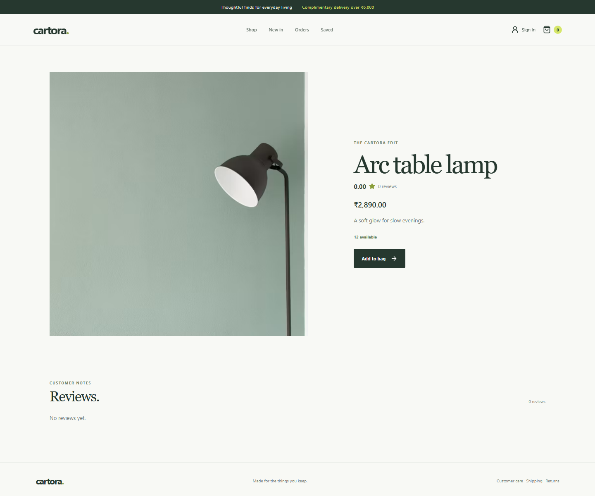

# Cartora

Cartora is a full-stack commerce application built around a Spring Boot REST API and a React storefront. It supports account registration and JWT login, product discovery, checkout, configurable simulated or Razorpay payments, order history, saved addresses, a wishlist, and verified-purchase product reviews.

## Project Status

The repository includes the storefront, customer account and purchase workflows, admin operations, database migrations, CI, and a Docker Compose deployment. Payments use the simulated provider by default; Razorpay test mode is available when backend credentials and webhook configuration are supplied.

Implemented in the repository:

- Customer registration, login, JWT authentication, profile updates, and password changes
- Password reset links with hashed, expiring, one-time tokens and optional SMTP delivery
- Product and category APIs, product search/filtering/pagination/sorting
- Admin-only product and category create/update/delete operations
- Product image management through validated remote URLs or admin-only JPEG/PNG/WebP uploads (5 MB limit)
- Customer cart, checkout preview, address snapshot, order creation/history/details/cancellation
- Stock reservation with row locks, 30-minute expiry for abandoned pending orders, simulated payment, Razorpay order creation/signature verification/webhooks/refunds with durable idempotent refund retries
- Order confirmation emails sent after successful payment commits when SMTP is configured
- Address create/read/update/delete and default-address selection
- Customer wishlist
- Verified-purchase product reviews and aggregate ratings
- Recently viewed products persisted per account (guest history stays in the browser and merges after sign-in)
- Photo-led, responsive storefront with category collections, search, price presets, and grid/list browsing
- Product quick views with quantity selection, a slide-out shopping bag, and comparison of up to three products (comparison persists in the browser)
- Product pages with related pieces, shared wishlist actions, loading states, and accessible shopping dialogs
- Admin order listing with guarded shipped/delivered status transitions
- Admin coupon creation/activation and validated checkout discounts
- Admin customer list, payment management, refunds, store metrics, and daily sales reporting
- React pages for browsing, product details, login/registration, cart, checkout with saved-address selection, orders, profile, addresses, wishlist, product inventory, category CRUD, coupons, customer/payment reporting, and order tracking
- PostgreSQL Flyway migrations, OpenAPI/Swagger docs, Dockerfiles, Compose, and GitHub Actions CI
- Backend service, security, checkout validation, and MockMvc tests

SMTP notifications and password-reset email links need mail environment variables. Razorpay requires merchant test credentials and a configured webhook before external sandbox callbacks can be exercised. See [API_DOCUMENTATION.md](API_DOCUMENTATION.md) and [ARCHITECTURE.md](ARCHITECTURE.md) for the current boundaries.

## Technology

- Backend: Java 21, Spring Boot, Spring MVC, Spring Data JPA, Hibernate, Spring Security, JWT, Bean Validation, Maven, Flyway, springdoc OpenAPI
- Database: PostgreSQL
- Frontend: React, TypeScript, Vite, Axios, React Router, Lucide
- Tests: JUnit 5, Mockito, AssertJ, Spring Boot Test, MockMvc, Spring Security Test

The Maven project targets Java 21. Local development and CI should use a JDK 21 toolchain.

## Architecture

```text
React UI (frontend)
       | Axios / JSON / Bearer JWT
       v
Spring MVC controllers
       v
Services (business rules and transactions)
       v
Spring Data JPA repositories
       v
PostgreSQL
```

Backend packages live under `com.ecom.cartora`; feature packages own their controllers, services, repositories, entities, and DTOs. The main modules are `auth`, `user`, `security`, `category`, `product`, `cart`, `checkout`, `order`, `payment`, `address`, `wishlist`, `review`, and `coupon`.

The frontend is in `frontend/src`. `api.ts` defines the Axios client, token handling, response types, and endpoint helpers. `App.tsx` contains routing and the current customer/admin screens; styles are in `App.css`, `index.css`, and `address.css`.

## Database Overview

The current domain includes users, categories, products, carts/cart items, orders/order items, payments, addresses, coupons, wishlist items, and product reviews. A user owns one cart and may own multiple addresses, orders, wishlist items, and reviews. Products belong to categories and are referenced by carts, orders, wishlists, and reviews. Order items snapshot product price at order time; orders store coupon code and discount amount. See [DATABASE_DESIGN.md](DATABASE_DESIGN.md) for the ER diagram and current relationships.

## Authentication

Registration is public and assigns the `CUSTOMER` role on the server. Login returns a JWT. Protected API calls use:

```http
Authorization: Bearer <token>
```

Product and category `GET` endpoints are available without login for storefront browsing. Product and category mutations require the `ADMIN` role. Other API operations require authentication and apply owner checks in the service layer where appropriate. Customer and admin routes are guarded in the React router as well as by API authorization. The React app stores the token in browser local storage and clears it after a 401 response; deployments with stricter browser-token requirements should move to a server-managed, HttpOnly cookie design.

## Checkout and Payment

1. The customer sends a shipping address to `POST /api/checkout` to validate stock and calculate a preview.
2. The customer creates a pending order with `POST /api/orders`; the order snapshots its shipping address, reserves inventory, and clears the cart atomically.
3. The configured payment provider handles the order. The default simulator returns test success/failure outcomes. Razorpay mode creates a provider order, verifies signed callbacks against provider-side payment details, and processes signed/idempotent webhooks. Failed gateway attempts can be retried on the same provider order so delayed callbacks remain reconcilable.
4. Successful payments confirm orders. Failed payments leave the order pending for retry. Cancellation releases reserved inventory. Admins can issue and track Razorpay refunds.

The simulated provider is for development only and must not be used to accept real payments. Razorpay requires merchant credentials configured in the backend environment.

## Run Locally

### Prerequisites

- Java 21
- PostgreSQL
- Node.js and npm

### Backend

For Docker Compose, copy `.env.example` to `.env` and set unique local credentials before starting the services. The Compose stack runs PostgreSQL, the API, and the built frontend together:

```powershell
docker compose up --build
```

The storefront is available at <http://localhost:5173>, the API at <http://localhost:8080>, and Swagger UI at <http://localhost:8080/swagger-ui.html>. Database data is stored in the `cartora-postgres` named volume. Set `PAYMENT_PROVIDER=razorpay` and supply Razorpay test key and webhook secrets to enable gateway checkout.

For running the API outside Docker, configure:

```text
DB_URL=jdbc:postgresql://localhost:5432/cartora
DB_USERNAME=<your database user>
DB_PASSWORD=<your database password>
JWT_SECRET=<long random secret>
JWT_EXPIRATION=3600000
```

From `backend/` run:

```powershell
.\mvnw.cmd spring-boot:run
```

The API listens on port `8080` by default. Local CORS origins allow `localhost` and `127.0.0.1` on Vite ports `5173` through `5180`; configure `app.cors.allowed-origins` for another frontend origin. Flyway runs the versioned SQL migrations in `backend/src/main/resources/db/migration`; Hibernate validates the migrated schema at startup.

### Frontend

From `frontend/` run:

```powershell
npm install
npm run dev
```

Open <http://127.0.0.1:5173/>. Vite proxies `/api` requests to `http://localhost:8080`. For another API host, set `VITE_API_BASE_URL` in the frontend environment.

For an empty local development database, `backend/scripts/seed-demo-catalog.sql` adds four categories and twelve sample products. It is optional, is not part of the Flyway migrations, and leaves existing category names and product SKUs unchanged. Run it explicitly using your PostgreSQL client:

```powershell
& "C:\Program Files\PostgreSQL\18\bin\psql.exe" -h localhost -p 5432 -U postgres -d cartora -W -v ON_ERROR_STOP=1 -f backend/scripts/seed-demo-catalog.sql
```

Run that command from the repository root. The bundled sample photography is served from `frontend/public/images`; replace the sample inventory with your own product information for a real store.

## Tests and Quality Checks

Run backend tests from `backend/`:

```powershell
.\mvnw.cmd test
```

Run frontend checks from `frontend/`:

```powershell
npm run build
npm run lint
```

The backend tests target PostgreSQL. CI provisions PostgreSQL and runs `./mvnw -B test`; the frontend job runs the production build and lint. See [TESTING_GUIDE.md](TESTING_GUIDE.md).

## API Reference

The primary endpoint list and request examples are in [API_DOCUMENTATION.md](API_DOCUMENTATION.md). Interactive OpenAPI/Swagger documentation is served at `/swagger-ui.html` and `/v3/api-docs`.

## Screenshots

Desktop storefront and product detail, plus a 390px mobile storefront preview:





## Contributing

1. Create a focused branch from `main` and keep changes scoped to one feature or fix.
2. For database changes, add a new Flyway migration instead of editing an already released migration.
3. Add or update tests with the behavior change. Do not commit credentials, `.env` files, generated uploads, or local database files.
4. Before opening a pull request, run the backend Maven tests with PostgreSQL available, then run the frontend production build and lint commands listed above.
5. Include a short summary, verification output, and screenshots for visible UI changes.

## Roadmap

- Verify full Razorpay sandbox webhooks using merchant test credentials
